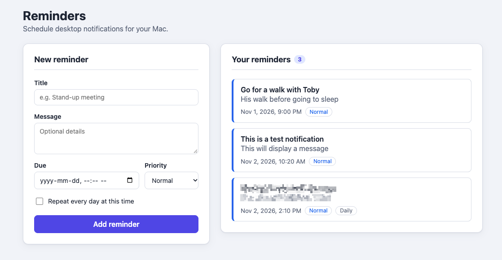
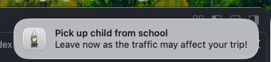

# MacReminder

Personal desktop reminders for macOS. You add reminders in a small web page, and a background job shows them as native macOS notifications when they are due.





## How it works

The app has three parts. They share one SQLite database at `src/reminder/db/reminders.db`.

| Part | What it does | Code |
|---|---|---|
| **Web page** | A React form for adding reminders and a list of existing ones | [`frontend/`](frontend/) |
| **API** | A FastAPI server that saves and lists reminders, and serves the web page | [`src/reminder/api.py`](src/reminder/api.py) |
| **Notifier** | A background job that macOS runs every 5 minutes; it shows reminders that are due | [`src/reminder/notifier.py`](src/reminder/notifier.py) |

When are reminders shown?

- **One-time reminders** are shown once, on the first run after their due time. If your Mac was asleep at the due time, the reminder is shown when it wakes up.
- **Daily reminders** ("Repeat every day at this time") are shown once a day, on the first run after that time of day.
- A reminder counts as shown only after macOS confirms it delivered the notification. If delivery fails, the next run tries again.

The notifier runs every 5 minutes, so a reminder can appear up to 5 minutes after its due time.

## Requirements

- macOS
- [uv](https://docs.astral.sh/uv/). It installs the right Python version (3.12 or newer) and the project's dependencies for you.
- [Node.js](https://nodejs.org/) 20.19+ or 22.12+, to build the web page

## Run it locally

### 1. Install dependencies

From the project root:

```bash
uv sync
cd frontend && npm install && npm run build && cd ..
```

- `uv sync` creates the `.venv` folder and installs the Python dependencies into it.
- `npm run build` builds the web page into `frontend/dist/`, the folder the API serves it from.

You need to build the web page before you start the API. If `frontend/dist/` is missing, the API refuses to start with `Frontend directory 'frontend/dist' does not exist`. Run `npm run build` again whenever you change files in `frontend/src/`.

### 2. Start the API

From the project root:

```bash
uv run fastapi dev src/reminder/api.py
```

Run this from the project root, because the API looks for `frontend/dist` relative to the folder you start it in. The database tables are created automatically on the first start.

### 3. Open the form

Open **http://127.0.0.1:8000** in your browser.

- **New reminder** (left): enter a title, an optional message, the due date and time, and a priority. Tick **Repeat every day at this time** for a daily reminder, then click **Add reminder**.
- **Your reminders** (right): all active reminders, sorted by due date. The coloured edge and badge show the priority: red for high, blue for normal, grey for low.

Due times are entered and shown in your local time zone. They are stored in UTC.

The API also has interactive documentation at **http://127.0.0.1:8000/docs**, where you can try the endpoints directly:

| Method | Path | Description |
|---|---|---|
| `GET` | `/reminders` | List all enabled reminders |
| `POST` | `/reminders` | Create a reminder; returns it with its new `id` (status `201`) |

### 4. Show due reminders once, by hand

To test notifications without installing the background job:

```bash
uv run python -m reminder.notifier
```

This shows every reminder that is due right now. The first time, macOS asks whether to allow notifications. Click **Allow**.

### Working on the web page

To see changes to the web page immediately, without rebuilding, run the Vite dev server next to the API:

```bash
uv run fastapi dev src/reminder/api.py   # terminal 1
cd frontend && npm run dev               # terminal 2
```

Then open **http://localhost:5173**. The page reloads whenever you save a file. Requests to `/reminders` are forwarded to the API on port 8000 (see [`frontend/vite.config.js`](frontend/vite.config.js)).

## Install on your Mac

Installing registers the notifier as a **launchd agent**: a background job that macOS starts at login and then runs every 5 minutes.

From the project root:

```bash
uv run python -m reminder.installer --install
```

This command:

1. Writes `~/Library/LaunchAgents/com.daily.reminder.plist`. The job uses the Python from this project's `.venv`, so it does not need `uv`.
2. Loads the job with `launchctl`, so it runs right away and then every 5 minutes.

Run the installer through `uv run`, as shown above. If you run it with a Python outside the project's `.venv`, it exits with an error and doesn't install anything.

**Allow notifications:** the first time the job runs, macOS asks for permission. If you miss the prompt or click **Don't Allow**, turn notifications on in **System Settings → Notifications**. The entry is usually listed as **Python**.

**Adding reminders after installing:** the installer sets up only the notifier. To use the form, start the API as described in [step 2](#2-start-the-api).

### Check that it is running

```bash
launchctl print gui/$(id -u)/com.daily.reminder
```

The job writes its output and errors to these files:

```bash
tail -f ~/Library/Logs/reminder.out ~/Library/Logs/reminder.err
```

### When to reinstall

The job remembers the absolute path of the project's `.venv` Python. Run `--install` again after you:

- move or rename the project folder
- delete and recreate `.venv`
- upgrade the Python version the project uses

Running `--install` again replaces the existing job.

### Uninstall

```bash
uv run python -m reminder.installer --uninstall
```

This stops the job and removes its plist. It doesn't delete your reminders.

## Database migrations

The API runs migrations automatically when it starts. To run them without starting the API:

```bash
uv run python -m reminder.installer --migrate
```

## Tests

```bash
uv run pytest
```

Each test runs against its own temporary database, so your real reminders are never touched. Build the web page first (`npm run build`), because importing the API requires `frontend/dist/`.

## Project structure

```text
MacReminder/
├── frontend/                  React web page (built with Vite)
│   ├── src/App.jsx            The form and the reminder list
│   └── dist/                  Built files served by the API (generated, not in git)
├── src/reminder/
│   ├── api.py                 FastAPI app: /reminders routes, serves frontend/dist
│   ├── notifier.py            Background job: shows due reminders
│   ├── installer.py           --install / --uninstall / --migrate
│   ├── models/schema.py       Pydantic models (request and response shapes)
│   ├── repositories/          SQL queries for reminders and the delivery log
│   ├── services/database.py   SQLite connection and migrations
│   ├── services/notification.py  Sends macOS notifications
│   └── db/                    The SQLite database (generated, not in git)
├── tests/                     API tests (pytest)
└── docs/                      Screenshots used in this README
```

## Limitations

- Reminders can't be edited or deleted from the web page yet.
- The API runs only while you keep it running. The notifier works without it.
- Daily reminders are stored in UTC, so after a daylight-saving change they appear one hour earlier or later in local time.
